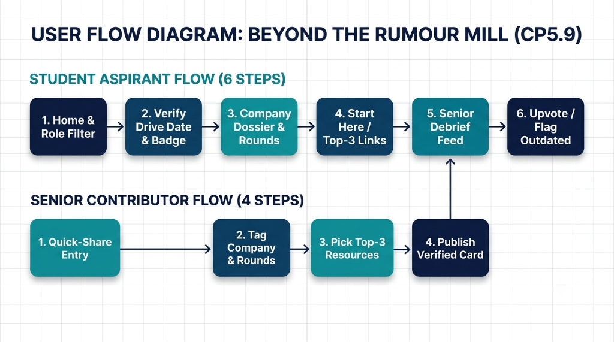

# LOVELY PROFESSIONAL UNIVERSITY (LPU)
## Course: INT335 – Design Thinking | Checkpoint 5 (CP5 — Week 10) Submission
### PROJECT P08: BEYOND THE RUMOUR MILL
#### Checkpoint 5 (CP5): Prototype Readiness — 6-Screen Architecture, User Flow & Usability Test Plan

---

### Project Attribute Summary
| Project Attribute | Details |
| :--- | :--- |
| **Project Code & Title** | P08 – Beyond the Rumour Mill |
| **Domain & Problem Area** | Placements and Career Services — Placement Preparation & Information Asymmetry |
| **Group & Section** | Group 5 | Section: K3P25ZY (School of Computer Science & Engineering) |
| **Faculty Mentor** | Komal Gupta |
| **Submission Stage** | Checkpoint 5 (CP5 – Week 10): Prototype Readiness |
| **Prototype Specs** | 6 Interactive Screens | Clickable Digital Prototype | 6 Planned Test Sessions (Week 11) |

---

### Team Members & Prototype Responsibilities (Group 5)
| S. No. | Student Name | Registration Number | CP5 Prototype Role |
| :---: | :--- | :---: | :--- |
| 1 | **Aayush Nehra** | 12509394 | **Team Lead** — Role Roadmap Structure & Content Curation |
| 2 | **Rani Kumari Pandit** | 12510112 | **UI / UX Lead** — 6-Screen Wireframe Layouts & Visual Hierarchy |
| 3 | **Vendra Shyam Karthik** | 12510149 | **Usability Moderator** — Senior Micro-Survey Flow & Test Moderator |
| 4 | **J Anirudh Reddy** | 12512643 | **Interactive Prototype Lead** — Interactive Logic, Verification Badges & Test Script |

---

## 1. Prototype Hypothesis & Core Loop (CP5.1 – CP5.2)

### CP5.1 Prototype Hypothesis
> **If** LPU placement aspirants are provided with timestamped, batch-verified company prep dossiers, structured topic roadmaps capped at 3 vetted study links per topic, and asynchronous 5-minute senior drive debriefs,  
> **then** they will verify recruitment details and choose relevant study resources faster and with significantly lower confusion than relying on informal WhatsApp groups or live senior DMs.

### 1.1 Core Loop Covered by the Prototype (CP5.2)
| Loop Stage | User Action & System Interaction |
| :--- | :--- |
| **Start** | An LPU student opens the hub while preparing for upcoming campus placement drives. |
| **Step 1: Discovery & Freshness Check** | Filters by target role or searches a company, checking the explicit batch/drive verification badge to confirm details are current rather than an outdated rumour (*INT-01 at 00:44; INT-02 at 00:51*). |
| **Step 2: Topic Curation** | Opens the canonical Company Dossier, views verified recruitment rounds, and picks from the capped 'Top 3 Vetted Resources' checklist for priority topics (*INT-01 at 00:58; INT-02 at 01:10*). |
| **Step 3: Asynchronous Senior Insight** | Reads structured 'Experienced Thoughts' debrief cards submitted by placed seniors via a 5-minute micro-survey (*INT-01 at 01:17; INT-02 at 01:01, 01:23*). |
| **Outcome** | The student leaves with a verified, actionable study checklist and real round insights without messaging busy seniors or sifting through repetitive forwards. |

---

## 2. Six-Screen Interactive Prototype Architecture (CP5.3 – CP5.4)

**Current Prototype Fidelity (CP5.4):** Clickable Digital Prototype comprising 6 interconnected screens (exceeding the 5-screen minimum) covering both the Placement Aspirant workflow and the Senior Contributor workflow.

| Screen # & Name | Key UI Elements | CP2 / CP3 Evidence Addressed |
| :--- | :--- | :--- |
| **Screen 1: Campus Drive Discovery Home** | Search bar, Role Filter pills (SDE, Analyst, Core), 'Start Here' beginner banner, and Company Cards with 'Verified Current' vs. 'Previous Batch' badges. | Eliminates WhatsApp forward clutter and gives stressed beginners an immediate entry point (*INT-01 at 01:32; INT-02 at 00:51*). |
| **Screen 2: 'Start Here' 4-Week Foundation Roadmap** | Ordered 4-week checklist (Aptitude -> Coding -> Core CS -> Projects) with progress tracker and curated starting links. | Directly resolves *"I don't know what to study, I don't know how to prepare"* (*INT-01 at 00:58*). |
| **Screen 3: Company Prep Dossier & Rounds** | Canonical company header with Drive Date, Batch Tag, CGPA/branch eligibility, round sequence, and topic weightage bars. | Replaces conflicting peer rumours with a single timestamped source of truth (*INT-01 at 00:44*). |
| **Screen 4: Curated Topic & Top-3 Vetted Links Drawer** | Expandable topic modules capping external links to the Top 3 senior-rated resources per topic with upvote counts. | Solves online resource selection paralysis (*"many online materials, don't know which is useful"*, *INT-02 at 01:10*). |
| **Screen 5: Senior 'Experienced Thoughts' & Flagging Feed** | Structured senior debrief cards (rounds faced, actual questions, common mistakes) plus 'Mark Helpful' and 'Report Outdated' buttons. | Delivers asynchronous senior guidance even when seniors are busy in placements (*INT-01 at 01:17; INT-02 at 01:01, 01:23*). |
| **Screen 6: 5-Minute Senior Micro-Survey Flow** | Lightweight 4-step mobile submission form allowing placed seniors to log rounds, key topics, and up to 3 links in under 5 minutes. | Ensures low-friction, scalable knowledge capture without overloading busy 4th-year seniors. |

---

## 3. User Flow Diagram (CP5.9) & Prototype Access (CP5.8)

### 3.1 Exported User Flow Diagram (CP5.9)
The user flow diagram illustrates the dual-track system mapping the 6-step Student Aspirant Flow to the 4-step Senior Contributor Flow:

#### Track 1: Student Aspirant Flow (6 Steps)
1. **Home & Role Filter:** Aspirants access the hub and filter drives by SDE, Analyst, or Core Engineering.
2. **Verify Drive Date & Badge:** Confirm whether the record is verified for the current 2026 batch or flagged as an older batch archive.
3. **Company Dossier & Rounds:** Review canonical eligibility criteria, interview round sequence, and topic weightage breakdown.
4. **Start Here / Top-3 Links:** Access high-yield preparation roadmaps strictly capped at 3 vetted study resources per topic.
5. **Senior Debrief Feed:** Read asynchronous interview debriefs submitted by placed seniors.
6. **Upvote / Flag Outdated:** Upvote helpful resources or submit a rumor flag if test patterns change.

#### Track 2: Senior Contributor Flow (4 Steps)
1. **Quick-Share Entry:** Placed seniors launch the lightweight 5-minute micro-survey.
2. **Tag Company & Rounds:** Select company, drive date, package tier, and interview sequence.
3. **Pick Top-3 Resources:** Recommend up to 3 high-yield study resources with specific rationale.
4. **Publish Verified Card:** One-click submission publishes the debrief card directly into the verified campus feed.

---

### 3.2 Shareable Clickable Prototype (CP5.8)
- **Local Interactive Server:** Run locally on `http://localhost:5173/` or `http://localhost:4173/`.
- **Interactive Usability Test Runner:** Built-in floating console running Tasks 1 to 4 with live stopwatch, neutral prompt script, and completion criteria.
- **Built with Modern Web Standards:** React 19, Tailwind CSS, Lucide icons, accessible `<dialog>` modals with overscroll isolation.

---

## 4. Usability Test Plan, Neutral Tasks & Moderator Script (CP5.5 – CP5.10)

### 4.1 Recruited Participants & Testing Schedule (CP5.6)
| Segment | Sample Size | Participant Profile | Planned Testing Schedule (Week 11) |
| :--- | :---: | :--- | :--- |
| **Primary Segment (Placement Aspirants)** | n = 4 students | LPU 2nd- and 3rd-year B.Tech students preparing for placements (2 modelled on Persona 1; 2 modelled on Persona 2). | **Days 1–2 of Week 11:** Four 15-minute individual moderated sessions on LPU campus. |
| **Secondary Segment (Senior Contributors)** | n = 2 seniors | LPU 4th-year / placed seniors who have completed campus recruitment interviews. | **Day 3 of Week 11:** Two 10-minute individual sessions testing the 5-minute debrief flow. |
| **Synthesis & Iteration** | All 4 Team Members | Group 5 consolidates task times, confusion points, and survey ratings into CP6 fixes. | **Day 4 of Week 11:** Prepare CP6 testing report and prototype refinements. |

---

### 4.2 Neutral User Test Tasks & Success Signals (CP5.5 & CP5.10)
| Task ID | Exact Neutral Task Prompt Presented to User (No Feature Hints) | Target User | Measurable Success Signals |
| :--- | :--- | :---: | :--- |
| **Task 1 (Verification)** | *"You heard from a classmate that a company is visiting campus soon, and you want to check what interview rounds and topics were asked in its most recent LPU drive. Using what is in front of you, find out whether the available information is up to date and identify the rounds tested."* | Placement Aspirants (n = 4) | • Completes in < 45 seconds without moderator help. • Correctly identifies drive date & verification status badge ('Verified Current' vs 'Previous Batch'). • Identifies the sequence of interview rounds tested. |
| **Task 2 (Curation)** | *"Imagine you are starting your preparation for a Software Developer role and feel unsure about what topics to study first or which online links to trust. Use this tool to decide your starting topics and pick two study resources."* | Placement Aspirants (n = 4) | • Navigates to roadmap from Home banner or nav tab. • Selects 2 vetted links from the capped checklist. • Post-task clarity score $\ge$ 4 / 5. |
| **Task 3 (Senior Input)** | *"Imagine you just completed a campus placement interview and want to leave practical advice for juniors without spending more than five minutes. Complete the process of sharing your round experience and top study links."* | Placed / 4th-Year Seniors (n = 2) | • Completes submission in < 5 minutes (300 seconds). • Zero drop-offs or confusion on the strict 3-resource limit. • Newly published debrief appears immediately in senior feed. |
| **Task 4 (Anti-Rumour)** | *"While browsing a company page, suppose you notice a detail that looks outdated from an older batch. Show how you would flag or respond to that information."* | Placement Aspirants (n = 4) | • Locates 'Report Outdated' control in < 20 seconds. • Opens flagging modal and logs clarification report. • Confirms system acknowledgement badge/toast. |

---

### 4.3 Standardized Moderator Test Script & Feedback Capture Method (CP5.7 & CP5.10)

#### Moderator Script (Strictly Neutral — Does Not Explain What the Prototype Does)
1. **Welcome & Consent (1 min):**  
   *"Thank you for helping us test an early prototype for our Design Thinking project. We are testing the tool, not you—there are no right or wrong answers. Please think aloud as you click through so we understand what makes sense and what feels confusing."*
2. **Silent Observation Rule (8–10 mins):**  
   Present Tasks 1–4 one at a time using the exact neutral prompts above. The moderator remains silent while the participant interacts with the screens, intervening only if the participant is completely blocked after 60 seconds (logging an assist).
3. **Feedback Capture Method (3 mins):**  
   Record:
   - (a) Task completion time (using built-in stopwatch)
   - (b) Number of wrong clicks/hesitations
   - (c) A 1–5 post-test rating on **Information Trust** and **Resource Clarity**
   - (d) Two open follow-up questions:
     - *"What felt most helpful?"*
     - *"What confused you or felt missing?"*

---

### 4.4 Usability Session Observation Sheet (Template for Week 11)
| Participant ID | Batch & Branch | Task 1 Time (s) | Task 2 Time (s) | Task 3 Time (s) | Task 4 Time (s) | Trust (1-5) | Clarity (1-5) | Key Qualitative Observation |
| :---: | :---: | :---: | :---: | :---: | :---: | :---: | :---: | :--- |
| **P-01** | B.Tech CSE (3rd Yr) | _ | _ | — | _ | _ | _ | _ |
| **P-02** | B.Tech IT (3rd Yr) | _ | _ | — | _ | _ | _ | _ |
| **P-03** | B.Tech ECE (2nd Yr) | _ | _ | — | _ | _ | _ | _ |
| **P-04** | B.Tech CSE (2nd Yr) | _ | _ | — | _ | _ | _ | _ |
| **S-01** | B.Tech CSE (Placed) | — | — | _ | — | _ | _ | _ |
| **S-02** | B.Tech IT (Placed) | — | — | _ | — | _ | _ | _ |
